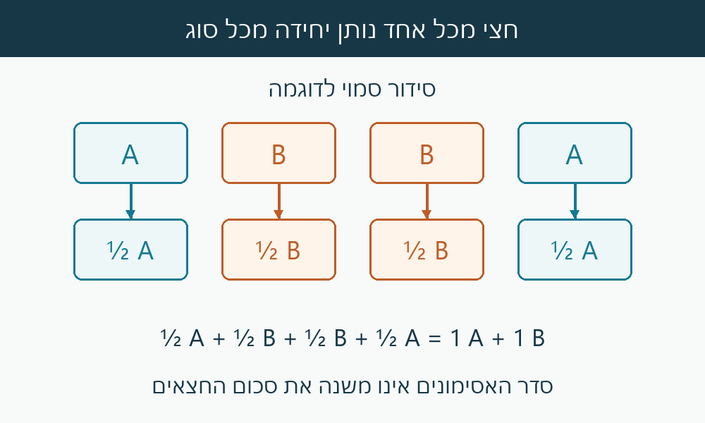
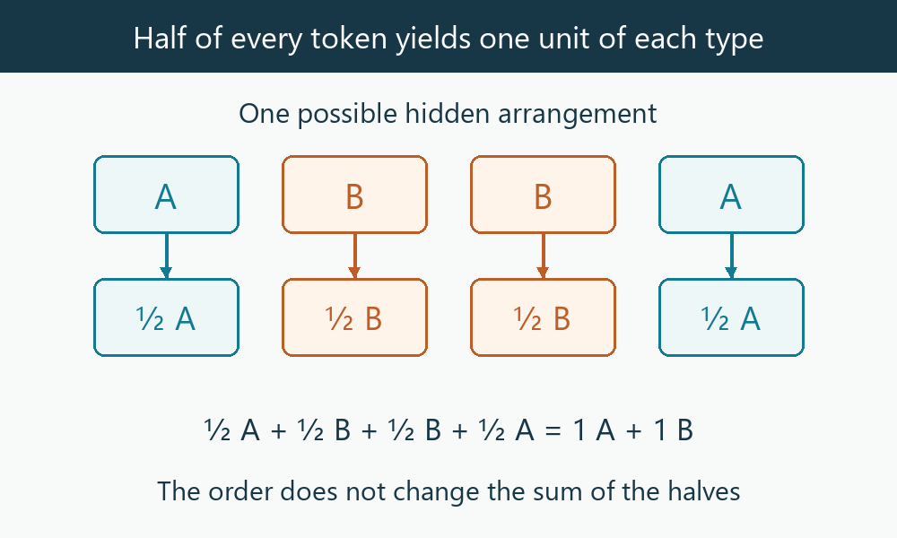

# PREP-376 — שני סוגים נסתרים וארבעה אסימונים

פתרון מוצע בסיוע AI. ממתין לביקורת מקצועית אנושית.

[צילום המקור](../sources/2026-11-18-batch31-14.png)

נתונות 4 גלולות, 2 מסוג רעל א׳ ו־2 מסוג רעל ב׳, וכל סוג מנטרל את השני. יש לקחת בסך הכול 2 כדורים מתוך ה־4 ולהבטיח הישרדות, כלומר כדור אחד מכל סוג. כל ארבעת הכדורים נראים זהים ולא ניתן להפריד ביניהם לפי המראה. איך והאם ניתן להבטיח הישרדות?

## שני סוגים נסתרים וארבעה אסימונים

ארבעה אסימונים נראים זהים. שניים שייכים לסוג A ושניים לסוג B. צריך לבנות אוסף שמכיל יחידה אחת מכל סוג, בלי יכולת למדוד את הסוג או לזהותו. א. האם אפשר להבטיח זאת בבחירת שני אסימונים שלמים? ב. האם התשובה משתנה אם מותר לחלק כל אסימון לשני חצאים שווים ואפשר לצרף חצאים על פי כמותם? הוכיחו את שתי התשובות.

### רמזים

1. לכל בחירה של שני אסימונים שלמים, האם ייתכן ששניהם מאותו סוג?
2. כמה יש בסך הכול מכל סוג? חפשו פעולה שנותנת אותה תשובה בלי תלות בסדר הסוגים.
3. אם מעבירים חצי מכל אחד מארבעת האסימונים, כמה נצבר מכל סוג?

### פתרון מוצע

### חצי מכל הכמות נותן חצי מכל סוג
בבחירה של שני אסימונים שלמים, שני המקומות שבחרנו יכולים להיות שני אסימוני A. אותו טיעון עובד לכל זוג קבוע, ובחירה אקראית מאפשרת כישלון. מתוך שש אפשרויות לא ממוספרות לבחירת שני מיקומים, ארבע כוללות אחד מכל סוג, כך שעם בחירה אחידה ההסתברות להצלחה היא `4/6 = 2/3`.

בחלק ב בוחרים חצי מכל אסימון. ארבעת החצאים מסתכמים בשתי יחידות. מהסוג A מתקבלים שני חצאים, כלומר יחידה אחת, וכך גם מהסוג B. המיקום של כל סוג אינו משפיע על הכמויות.

אפשר לראות מדוע חלוקה אחידה מופיעה כאן. נסמן ב־`w_i` את החלק שנלקח ממיקום `i`. כל זוג מיקומים יכול להיות בדיוק זוג אסימוני A. להבטחה צריך ש־`w_i + w_j = 1` לכל זוג שונה. השוואה בין זוגות החולקים מיקום כופה על כל המשקלים להיות שווים, ולכן כולם `1/2`.

### הנחות

לכל אסימון כמות אחת מסוג יחיד. החלוקה בחלק ב מדויקת, והכמויות של אותו סוג מתחברות.

### מקרה קצה

בחירת חצי משני אסימונים ואסימון שלם נוסף אינה מבטיחה איזון. שני החצאים יכולים להיות מאותו סוג של האסימון השלם.

### טעות נפוצה

להחליף ודאות בהסתברות גבוהה. קיומו של סידור אחד שבו נבחרו שני אסימונים מאותו סוג מספיק כדי לשלול הבטחה.

### סיבוכיות או עלות

הבחירה של חצי מכל אסימון היא הבחירה היחידה במשקלים קבועים שמצליחה בכל סידור חוקי.

### בדיקות

נסרקו כל שש ההקצאות הסמויות וכל זוגות הבחירה השלמים. חלוקת החצאים מצליחה בכל הקצאה.

### תשובה קצרה

אין זוג שלם שמבטיח אחד מכל סוג. חצי מכל אסימון נותן חצי מסך הכמות של A וחצי מסך הכמות של B, כלומר יחידה מכל סוג.

### שאלת המשך

איך בונים יחידה מכל סוג כאשר יש k אסימונים מכל סוג והם ניתנים לחלוקה מדויקת? קחו 1/k מכל אסימון. הכמות מכל סוג תהיה בדיוק 1.

## Four tokens with two hidden types

Four tokens look identical. Two are of type A and two of type B. Assemble a collection containing one unit of each type without being able to measure or identify the type of a token. A. Can you guarantee this by selecting two whole tokens? B. Does the answer change if you may divide each token into two equal halves and combine the halves by quantity? Prove both answers.

### Hints

1. For any two whole tokens you choose, could both have the same type?
2. How much of each type exists in total? Look for an operation whose outcome is independent of the arrangement.
3. If you keep one half of each of the four tokens, how much of each type accumulates?

### Proposed solution

### Half of the total gives half of each type
For any two chosen whole tokens, those two positions can both contain type A. A random choice also permits failure. Of the six unordered pairs of positions, four contain one of each type, so a uniform random pair succeeds with probability `4/6 = 2/3`.

In part B, keep half of every token. The four halves total two units. The two A tokens each contribute half a unit, totaling one unit of A. The same holds for B, regardless of where the types were placed.

The need for equal shares follows from a simple constraint. Let `w_i` denote the portion taken from position `i`. Every pair of positions could be the A pair. A guarantee requires `w_i + w_j = 1` for every distinct pair. Comparing sums with a shared position forces all weights to be equal, so they are all `1/2`.

### Assumptions

Each token holds one unit of one type. Division in part B is exact, and amounts of the same type add.

### Edge case

Taking one half of two tokens plus one whole token fails when the whole token and one of the halves share their type.

### Common mistake

Confusing a chance of success with a guarantee. One valid arrangement that yields two tokens of the same type defeats the guarantee.

### Cost

Half of each token is the unique fixed-weight choice that succeeds for every valid assignment.

### Verification

All six hidden assignments and all whole-token pairs were enumerated. The halves succeed on every assignment.

### Interview answer

No whole pair guarantees one of each type. Half of each token gives half of the total of each type, which is one unit apiece.

### Follow-up

How can you get one unit of each type when k tokens of each type are present and exactly divisible? Keep 1/k of each token. Exactly one unit of each type is collected.

[checks/check_nov18_reasoning.py](../checks/check_nov18_reasoning.py)

[checks/prep-376-1118-verification.json](../checks/prep-376-1118-verification.json)
