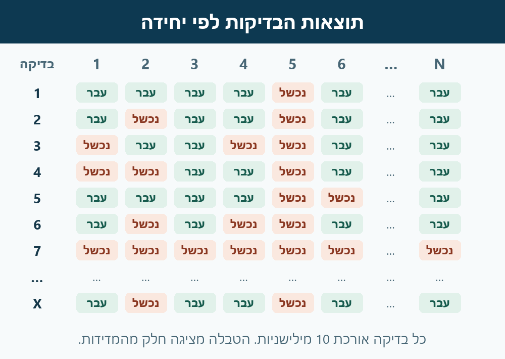
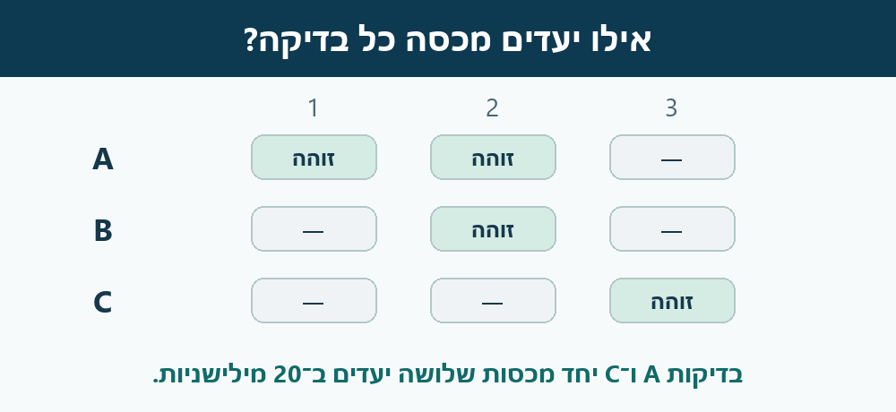
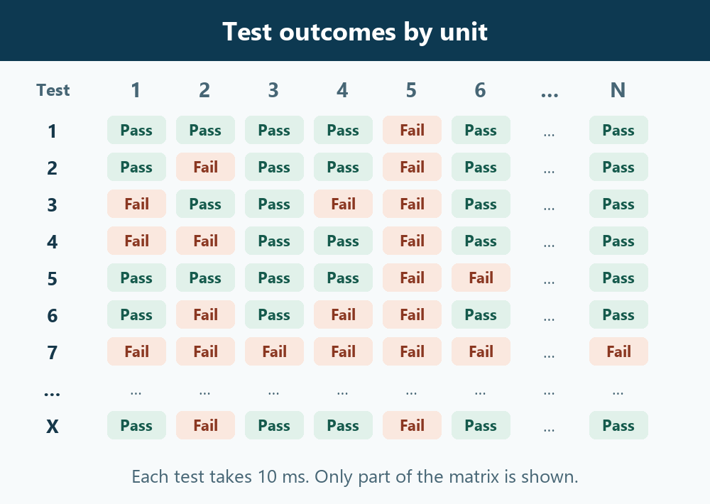
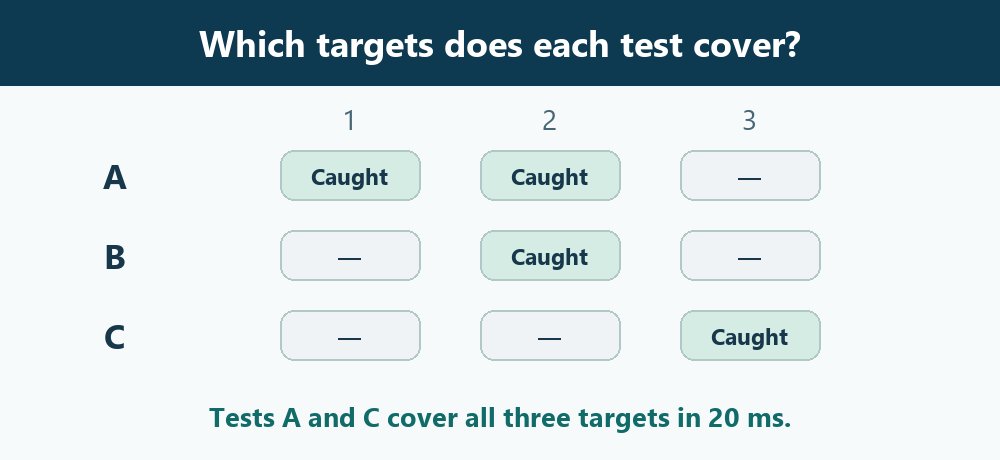

# PREP-377 — Choosing a shorter test suite from a failure matrix

Proposed solution. Model verification recorded below. Professional human review pending.

## צמצום זמן בדיקה בעזרת מטריצת כשלים

כל בדיקה של יחידה אורכת 10 מילישניות. בטבלה מופיע חלק מתוצאות הבדיקות ההיסטוריות. אילו בדיקות אפשר לשקול להסיר, וכיצד תחליטו אם החיסכון מצדיק זאת? התייחסו לבדיקה שמכשילה את כל היחידות המוצגות, לזיהוי יחידה פגומה וליכולת להבחין בין סוגי תקלות.

1. עקבו אחרי יחידה אחת לאורך הטור שלה. מה מלמדת המשמעות של כשל בבדיקה אם מצב היחידה אינו ידוע?
2. השוו את קבוצות היחידות שכל בדיקה מזהה. מה מוסיפה בדיקה שנייה אחרי שבחרתם את הראשונה?
3. בדקו יחידות תקינות ידועות ובחנו את הכיסוי הנבחר על אצווה נפרדת. לאבחון, בדקו אילו זוגות תקלות עדיין נותנים אותה חתימה.

### מה רוצים לשמר
לצורך סינון, קובעים קבוצת תקלות או יחידות פגומות שסומנו באופן בלתי תלוי, ואת שיעור פסילות השווא המותר. עבור בדיקה i מסמנים ב־Fᵢ את הפגומים שהיא מזהה. בחירת בדיקות שאיחוד הקבוצות שלהן מכסה את כל היעדים היא בעיית כיסוי קבוצות. אם אין תוויות אמת, אפשר לכל היותר לשחזר את הדחיות של הסדרה הישנה על המדגם הזה.

### בחירת בדיקות
שומרים תחילה בדיקות חובה. בכל צעד מוסיפים את הבדיקה שמזהה הכי הרבה יעדים שטרם כוסו, ומעדכנים את קבוצת היעדים שנותרו. קבוצה ריקה, שורה זהה או קבוצה המוכלת בבדיקה אחרת באותה עלות הן מועמדות להסרה, בתנאי שלבדיקה שנשארת אין מחיר גבוה יותר בפסילות שווא ושאין דרישות אבחון או יתירות. יעדים חיוניים מקבלים דרישה משלהם. על מטריצה קטנה אפשר לעבור על כל תתי־הקבוצות ולבחור את הקטנה הכשרה.

### מה אפשר להסיק מהטבלה
בקטע המוצג שורת X זהה לשורה 2, ושורה 7 מכשילה כל יחידה. העמודות החסרות עשויות להבדיל בין 2 ל־X. אם המטרה היא רק לשחזר את דחיות המדגם המוצג, שורה 7 מספיקה לבדה. כדי להכריע אם היא שימושית מריצים אותה על יחידות תקינות ידועות ובודקים גם את מערך הבדיקה. לאבחון, שתי תקלות מובחנות אם לפחות בדיקה אחת נותנת להן תוצאה שונה.

לדוגמה, בדיקות A,B,C מזהות בהתאמה {1,2}, {2}, {3}. A ו־C מכסות את שלושת היעדים ב־20 מילישניות במקום 30. לפני הסרה בפועל משווים על אצווה נפרדת פסילות שווא, פגומים שחמקו וכיסוי של תקלות נדירות. בסדרה שרצה במלואה, הסרת k בדיקות חוסכת 10k מילישניות ליחידה.

## Choosing a shorter test suite from a failure matrix

Each test takes 10 ms per unit. The table shows part of a historical pass/fail matrix. Which tests are candidates for removal, and how would you decide whether the saving is justified? Address the row that fails every visible unit, detecting defective units, and distinguishing fault types.

1. Follow a unit down one column. What does a failing test tell you if the unit's condition is unknown?
2. Compare the sets of units detected by each test. What does a second test add once the first has been chosen?
3. Include known-good controls and evaluate the subset on another lot. For diagnosis, check which fault pairs still have indistinguishable signatures.

### Define what must survive pruning
For screening, identify independently labelled bad units or fault classes and a false-reject limit. Let Fᵢ be the targets detected by test i. Finding a subset whose union contains every required target is set cover. Without ground truth, the historical matrix can establish agreement with previous rejections only for the observed sample.

### Select and validate
Start with mandatory tests. Repeatedly add the vetted test that catches the most uncovered targets and remove those targets from the outstanding set. Empty, duplicate or dominated rows are removal candidates if a retained equal-cost test covers the same targets with acceptable false rejects, and diagnostic or redundancy requirements permit it. Protect rare critical faults explicitly. For a small matrix, enumerate subsets and choose the smallest feasible one.

### Interpreting the given excerpt
Rows X and 2 agree on the visible columns. Hidden columns could distinguish them. Row 7 alone reproduces every rejection on the visible sample. Test known-good controls and check the fixture before treating universal failure as evidence of a good screen. For diagnosis, a pair of faults is distinguishable if a retained test gives different outcomes for them.

For example, tests A, B and C catch {1,2}, {2} and {3} respectively. A and C cover all three targets in 20 ms instead of 30. Replay the proposed suite on a separate lot and count escapes, false rejects and coverage of rare faults. For a sequential suite that runs to completion, removing k tests saves 10k ms per unit.

[Teaching model](../solutions/prep_377_test_selection.py)
[Verification script](../checks/check_validation1118b.py)
[Verification report](../checks/validation1118b-verification.json)
[Private source 3](../sources/2026-11-18-batch21-03.png)
