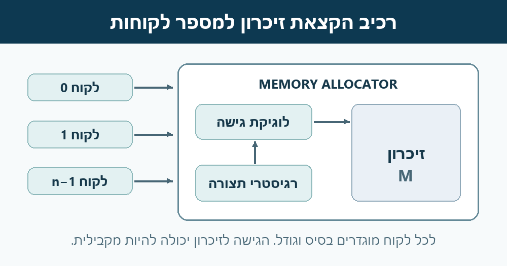
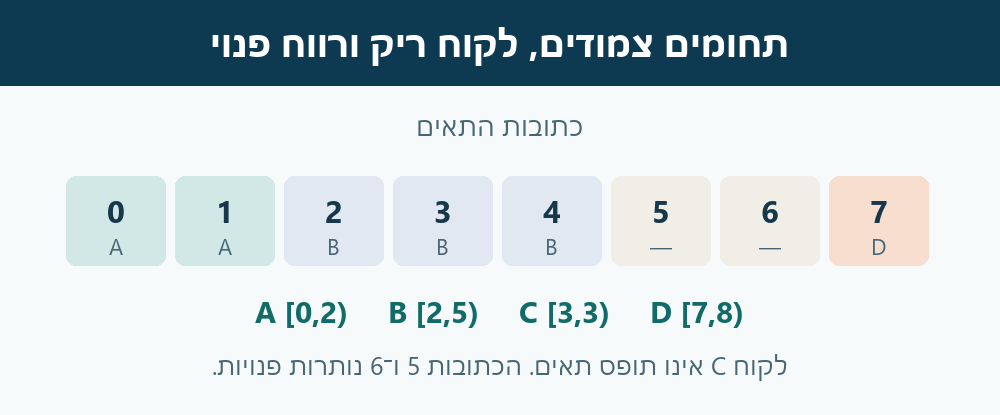
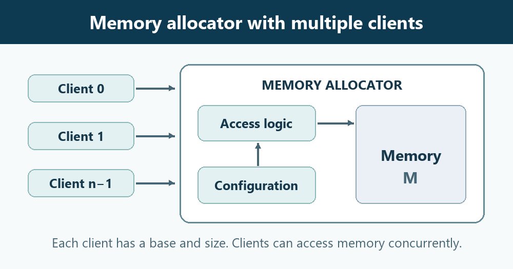
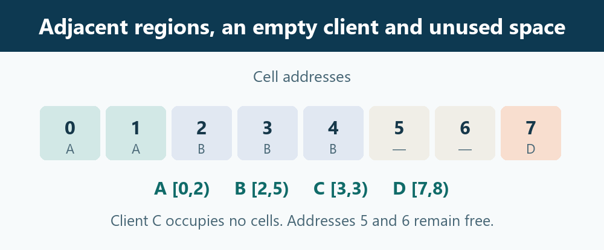

# PREP-378 — Generating memory layouts and verifying client isolation

Proposed solution. Model verification recorded below. Professional human review pending.

## חלוקת זיכרון ובדיקת בידוד בין לקוחות

רכיב מקצה ל־n לקוחות תחומים רציפים בזיכרון בעל m תאים. כל לקוח מוגדר בכתובת התחלה ובגודל ויכול לקרוא ולכתוב במקביל לאחרים. אסור לחרוג מהזיכרון או ליצור חפיפה בין אזורים מוקצים. גם לקוח שגודלו אפס מקבל כתובת חוקית. הציעו בדיקות לרכיב, ממשו func(n,m) שמחזירה את המערכים size ו־adrs, והציעו מחולל מגוון יותר בעזרת randomize(a,b) הכוללת את הקצוות ו־sort. הסבירו אילו מקרים מחמיצה חלוקה שווה ואיך תבדקו את המחולל עצמו.

1. כתבו את הכתובות של לקוח אחד כטווח חצי פתוח. מה קורה בגודל אפס?
2. מנו בנפרד גדלים, רווחים פנויים וסדר לקוחות. אילו מהם משתנים כשמחלקים שווה בשווה?
3. מיינו נקודות חיתוך בזוגות, ערבבו את זהויות הלקוחות ובדקו כל תוצאה בעזרת מפת בעלות בלתי תלויה.

### חלוקה בסיסית
עבור n>0 ו־m>0 מחשבים q,r = divmod(m,n). כל אחד מ־r הלקוחות הראשונים מקבל q+1 תאים והאחרים מקבלים q. כתובת ההתחלה היא סכום הגדלים הקודמים. אם הגודל אפס והסכום כבר הגיע ל־m, בוחרים למשל m−1. לדוגמה, עבור n=3 ו־m=8 אפשר להחזיר גדלים [3,3,2] ובסיסים [0,3,6]. בלי לקוחות מחזירים שני מערכים ריקים. אם יש לקוחות אבל אין אפילו כתובת חוקית אחת, מדווחים על קלט בלתי אפשרי.

### חלוקה אקראית
מגרילים 2n נקודות בתחום הסגור [0,m] וממיינים. קוראים זוגות עוקבים (s,e). כל זוג מגדיר טווח [s,e), בגודל e−s. מסדר המיון נובע שסוף כל תחום קטן או שווה להתחלת הבא. הרווחים בין הזוגות הם זיכרון פנוי. נקודות שוות יוצרות לקוח ריק, ואז מגרילים לו כתובת חוקית בין 0 ל־m−1. מערבבים את זהויות הלקוחות לפני הצמדתם לזוגות. כך אפשר ליצור גם בסיס גבוה ללקוח הראשון, רווחים בקצוות וגדלים שונים. התפלגות התצורות אינה אחידה. משלבים תצורות מכוונות כגון לקוח יחיד שתופס הכול, מגע מדויק בין תחומים וגישה לתא האחרון.

### בדיקת הרכיב
בודקים כתובת התחלה, כתובת אחרונה וגישה אחת מחוץ לטווח לפי התגובה שמוגדרת במפרט. כותבים חתימה שונה דרך כל לקוח, קוראים דרך אותו לקוח ומשווים למודל ייחוס של תאים ובעלים. מריצים במקביל קריאות וכתיבות בתחומים שונים ומוודאים שהערכים נשמרים. אם מזריקים תצורה לא חוקית, ציפיית הדחייה תלויה במפרט. בדיקת המחולל נפרדת: מסמנים כל תא בכל אזור חי ומכשילים על סימון חוזר, כתובת פסולה או אורך שאינו מתאים.

## Generating memory layouts and verifying client isolation

A component assigns contiguous regions of an m-cell memory to n clients. Each client has a base address and a size and can read and write concurrently with other clients. Allocations must be in bounds and disjoint. Even a zero-size client needs a legal base. Propose component tests, implement func(n,m) returning size and adrs arrays, and design a more varied generator using inclusive randomize(a,b) and sort. Explain what equal partitions miss and how you will check the generator.

1. Write a client's addresses as a half-open interval. What does a size of zero mean?
2. Separate region lengths, unused gaps and client ordering. Which ones does an equal split vary?
3. Sort sampled boundaries into pairs, permute client IDs and check each layout using an independent ownership map.

### Start with a deterministic layout
For n>0 and m>0 compute q,r = divmod(m,n). Give q+1 cells to the first r clients and q cells to the rest. Prefix sums supply the bases. When an empty region would start at m, use a legal dummy base such as m−1. For n=3 and m=8 one result has sizes [3,3,2] and bases [0,3,6]. No clients yields two empty arrays. Clients with no addressable cells make the legal-base contract impossible.

### Randomize layouts
Draw 2n integer cuts from [0,m], sort and take consecutive pairs (s,e). The interval [s,e) has size e−s. Sorting puts every end at or before the next start, leaving all inter-pair gaps unallocated. Equal cuts create an empty region. Assign that client any random base in [0,m−1]. Shuffle the client IDs before assigning pairs. This explores different sizes, unused space and address order. Layouts do not have equal probability. Add directed cases for rare arrangements such as one client owning everything, adjacent regions and access to the last cell.

### Verify the component
Exercise the first and last legal addresses and the specified response to a one-past-end access. Write distinct client signatures, read back through each owner and compare with an independent per-cell reference. Interleave concurrent writes and reads in disjoint regions and check the retained values. The expected reaction to an illegal configuration depends on the interface contract. Check the generator separately by marking every allocated cell and rejecting overlaps, invalid bases or inconsistent sizes.

[Teaching model](../solutions/prep_378_memory_partitions.py)
[Verification script](../checks/check_validation1118b.py)
[Verification report](../checks/validation1118b-verification.json)
[Private source 4](../sources/2026-11-18-batch21-04.png)
[Private source 5](../sources/2026-11-18-batch21-05.png)
