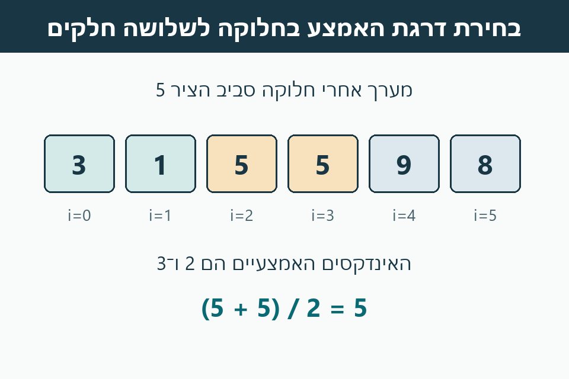
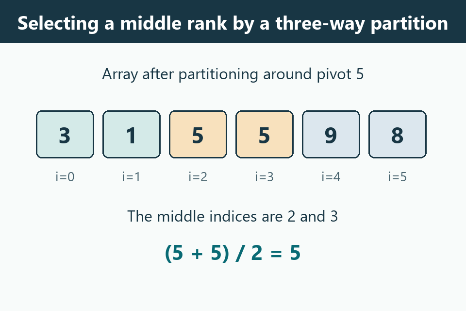

# PREP-379 — חציון של מערך לא ממוין

פתרון מוצע בסיוע AI. ממתין לביקורת מקצועית אנושית.

[צילום המקור](../sources/2026-11-18-batch21-06.png)

נתון מערך מספרים לא ממוין. מצאו את החציון שלו.

## חציון של מערך לא ממוין

נתון מערך לא ממוין של מספרים שלמים מסומנים ברוחב 32 ביט, וייתכנו חזרות. החזירו את החציון. למספר זוגי של איברים החזירו את הממוצע של שני האיברים האמצעיים בסדר הממוין, ולמערך ריק החזירו None. מותר לשנות את סדר הקלט. תנו פתרון פשוט, ואז נסו להשיג זמן ריצה ליניארי בתוחלת בלי למיין את כל המערך.

### רמזים

1. לאילו מקומות במערך הממוין יש השפעה על התשובה?
2. בחרו ציר באקראי וחלקו את הערכים לקטנים, שווים וגדולים ממנו. באיזה חלק נמצאת דרגת האמצע?
3. חפשו את הדרגה n//2. במקרה הזוגי, אחרי שהדרגה נמצאה, הערך הקודם לה בסדר הממוין הוא המקסימום בין התאים שמשמאלה.

### פתרון מוצע

אם ממיינים, עבור n אי־זוגי התשובה היא האיבר באינדקס n//2. עבור n זוגי ממַצעים את האיברים באינדקסים n//2−1 ו־n//2. זהו פתרון בזמן O(n log n). למשל [9,1,8,2] הופך ל־[1,2,8,9] והחציון הוא 5.

כדי לבחור רק דרגה אחת, מתחילים עם כל הטווח ובוחרים מתוכו ציר אחיד באקראי. מחלקים במקום לשלוש קבוצות עוקבות לפי היחס לציר. אם דרגת האמצע נופלת בקבוצת השווים יודעים מה ערכה. אחרת ממשיכים רק בצד המכיל אותה. בכל סבב האיברים שמחוץ לטווח כבר נמצאים בצד הנכון של כל דרגה שאנחנו עדיין מחפשים. לכן בסיום, כל האיברים משמאל לאינדקס שנבחר קטנים ממנו או שווים לו, וכולם מימינו גדולים ממנו או שווים לו.

במקרה הזוגי, הגדול מבין האיברים שמשמאל הוא בדיוק ערך הדרגה הקודמת, גם אם יש חזרות. ממַצעים אותו ואת הציר. סכום שני ערכי int32 נכנס בשלֵם בן 64 ביט, והחצאים שמתקבלים בתחום זה ניתנים לייצוג מדויק גם ב־binary64. הקוד משתמש בשלמים של Python בחיבור.

```python
from random import randrange


def median(values):
    """Find the sample median of signed 32-bit integers. May reorder values."""
    n = len(values)
    if not n:
        return None
    middle = n // 2
    lo, hi = 0, n
    while True:
        pivot = values[randrange(lo, hi)]
        left = scan = lo
        right = hi
        while scan < right:
            if values[scan] < pivot:
                values[left], values[scan] = values[scan], values[left]
                left += 1
                scan += 1
            elif values[scan] > pivot:
                right -= 1
                values[scan], values[right] = values[right], values[scan]
            else:
                scan += 1
        if middle < left:
            hi = left
        elif middle >= right:
            lo = right
        else:
            break

    if n % 2:
        return pivot
    lower = max(values[i] for i in range(middle))
    return (lower + pivot) / 2
```



### הנחות

מותר לסדר את הקלט מחדש. ערכי הקלט הם int32 והמחולל בוחר אינדקס אחיד בכל סבב.

### מקרה קצה

בקלט [4,4,4,4] קבוצת השווים מכילה את שתי הדרגות. בקלט [−2,1] התוצאה היא ‎−0.5.

### טעות נפוצה

בחירה של איבר אמצעי יחיד עבור אורך זוגי מחמיצה חצי מההגדרה. אין לקחת את התא הקודם בלי למצוא את המקסימום בקידומת שעדיין אינה ממוינת.

### סיבוכיות או עלות

כל חלוקה סורקת את הטווח הפעיל. לציר אחיד יש הסתברות של כחצי ליפול במחצית המרכזית, ואז נשארים לכל היותר כשלושה רבעים מהטווח. הסכום הצפוי גאומטרי ולכן O(n). רצף צירים קיצוניים יכול לעלות O(n²). המימוש האיטרטיבי משתמש ב־O(1) תאי עזר.

### בדיקות

נבדקו מערכים קצרים בכל הצירופים מול חציון שהתקבל ממיון, וגם ערכי הקצה של int32.

### תשובה קצרה

מוצאים את הדרגה האמצעית באמצעות חלוקה לשלושה חלקים. במערך זוגי מוצאים גם את המקסימום שמשמאלה וממצעים.

### שאלת המשך

ומה אם אסור לשנות את המערך? אפשר לעבוד על עותק בגודל n ולשמור את הקלט המקורי.

## Median of an unsorted array

An unsorted array contains signed 32-bit integers and may contain duplicates. Return its median. For even length return the mean of the two middle values in sorted order. For an empty array return None. You may reorder the input. Give a simple solution, then try to reach expected linear time without sorting the entire array.

### Hints

1. Which sorted positions affect the answer?
2. Choose a random pivot and divide values into smaller, equal and larger groups. Which group contains the middle rank?
3. Select rank n//2. For even length, after locating this rank the preceding sorted value is the maximum over the positions to its left.

### Proposed solution

Sorting gives the element at index n//2 for odd n and the mean of elements at n//2−1 and n//2 for even n. This takes O(n log n) time. For example [9,1,8,2] sorts to [1,2,8,9] and the median is 5.

To select just one rank, start with the full active interval and choose a pivot uniformly from it. Partition in place into contiguous less-than, equal and greater-than bands. If the middle rank is in the equal band, its value is known. Otherwise keep only the side containing the rank. Each discarded prefix or suffix is already on the correct side of every remaining candidate. On termination all positions left of the selected index contain values at most the pivot, and all positions to its right contain values at least the pivot.

For even length, the largest element to the left therefore has exactly the previous sorted rank, including ties. Average it with the pivot. A sum of two signed 32-bit values fits in a signed 64-bit intermediate. Halves in this range are exactly representable in binary64. The code adds Python integers before dividing.

```python
from random import randrange


def median(values):
    """Find the sample median of signed 32-bit integers. May reorder values."""
    n = len(values)
    if not n:
        return None
    middle = n // 2
    lo, hi = 0, n
    while True:
        pivot = values[randrange(lo, hi)]
        left = scan = lo
        right = hi
        while scan < right:
            if values[scan] < pivot:
                values[left], values[scan] = values[scan], values[left]
                left += 1
                scan += 1
            elif values[scan] > pivot:
                right -= 1
                values[scan], values[right] = values[right], values[scan]
            else:
                scan += 1
        if middle < left:
            hi = left
        elif middle >= right:
            lo = right
        else:
            break

    if n % 2:
        return pivot
    lower = max(values[i] for i in range(middle))
    return (lower + pivot) / 2
```



### Assumptions

The input may be reordered. Values are int32, with a uniform pivot index on each pass.

### Edge case

With [4,4,4,4] the equal band contains both ranks. With [−2,1] the result is −0.5.

### Common mistake

Returning only the upper middle for even length changes the median. The position immediately to its left need not hold the lower middle until the prefix is sorted.

### Cost

Each partition scans the active interval. A uniform pivot has roughly one-half probability of lying in its middle half, leaving at most about three quarters. Expected work sums as a geometric series to O(n). Repeated extreme pivots cost O(n²) in the worst case. Iterative selection uses O(1) working cells.

### Verification

Compared exhaustive small arrays with sorted-reference medians and checked int32 extrema.

### Interview answer

Select the middle rank with a three-way partition. For even length scan its left prefix for the other middle value and average them.

### Follow-up

What changes if the input is read-only? Copy n values and partition the copy to preserve the original.

[checks/check_nov18b_software.py](../checks/check_nov18b_software.py)

[checks/prep-379-1118b-verification.json](../checks/prep-379-1118b-verification.json)

[solutions/prep_379_unsorted_median.py](../solutions/prep_379_unsorted_median.py)
