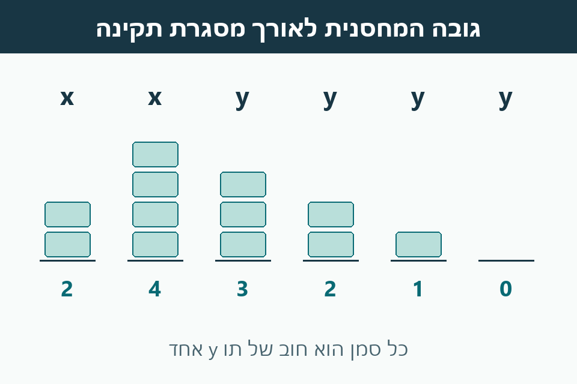
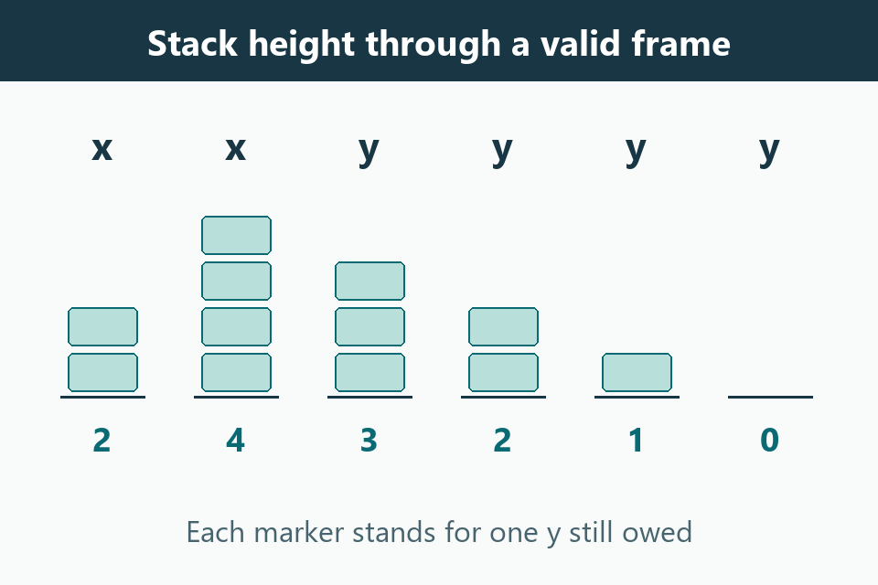

# PREP-380 — אימות רצף של x ואחריהם מספר כפול של y

פתרון מוצע בסיוע AI. ממתין לביקורת מקצועית אנושית.

[צילום המקור](../sources/2026-11-18-batch21-11.png)

יש לנו משדר ומקלט, המשדר שולח תווים ברצף והוא מסיים כאשר שולח "\". המשדר יכול לשדר תו כלשהו אבל המקלט מעוניין רק בתווים x ו-y. המקלט יש לו הפונקציות הבאות: push(), pop(), isEmpty(), whatCharIsComing(). הפונקציה האחרונה פשוט מחזירה את התו ששודר אחרון ושום דבר אחר.
המטרה היא להחזיר בסוף השידור האם התקבל הרצף x^n y^2n כלומר מספר ה-y-ים הוא פי 2 ממספר ה-x-ים או לא (כלומר false).
example1: xxyyyy -> true
example2: yyx -> false כי צריך קודם x-ים ואז y-ים.
example3: xya -> false כי יש בו תו שהוא לא x ולא y.

## אימות רצף של x ואחריהם מספר כפול של y

מקלט מקבל אירוע לכל תו. באירוע, whatCharIsComing() מחזירה את התו שהגיע עכשיו. לוכסן הפוך (\) מסיים את השידור ואינו חלק מהתוכן. בעזרת push, pop ו־isEmpty בלבד על מחסנית ריקה ומספר קבוע של דגלים, קבעו בסיום אם התוכן הוא x^n ואחריו y^(2n) עבור n≥0. כל תו אחר פוסל. למשל xxyyyy מתקבל, ואילו yyx ו־xya נפסלים. בהדגמת הקוד, feed מקבלת את התו שנקרא וכל קריאה מתייחסת לאירוע יחיד.

### רמזים

1. מה צריך לזכור מכל x עד שמגיעים תווי y?
2. כל x יוצר התחייבות לשני תווי y. איזה מידע חסר אם זוכרים רק כמה התחייבויות נותרו?
3. דחפו שני סמנים לכל x. אחרי ה־y הראשון, כל x פוסל את המסגרת. שלפו סמן לכל y וקבלו בסיום רק אם אין חוב ולא אירעה שגיאה.

### פתרון מוצע

בכל אירוע קוראים פעם אחת את התו החדש. אין להסיק שתו התקבל מתוך שינוי בערך, כי x ואחריו x הם שני אירועים שונים. לפני ה־y הראשון, כל x מוסיף שני סמנים. בכל y בודקים שהמחסנית אינה ריקה, שולפים סמן אחד ועוברים לשלב ה־y. בשלב זה x פוסל. תו זר או ניסיון לשלוף בלי סמן פוסלים את המסגרת. ממשיכים לצרוך אירועים עד הלוכסן ומחזירים אמת רק אם המסגרת נשארה תקינה והמחסנית ריקה.

אחרי כל קידומת תקינה גובה המחסנית הוא פעמיים מספר תווי x פחות מספר תווי y, והדגל מבטיח שכל ה־x קדמו לכל ה־y. לכן התרוקנות בסוף שקולה לשוויון המבוקש. לדוגמה ב־xxyyyy הגבהים הם 2,4,3,2,1,0. ב־xyyx היתרה זמנית אפס, אבל ה־x האחרון מפר את הסדר.

הקוד מעבד מסגרת אחת. הפונקציה accepts_frame מוסיפה מתאם בדיקה לאירועי תווים ומחזירה False אם השידור נגמר בלי תו סיום.

```python
class Receiver:
    """Call feed exactly once for each newly delivered character."""

    def __init__(self, push, pop, is_empty):
        self.push = push
        self.pop = pop
        self.is_empty = is_empty
        self.reading_y = False
        self.valid = True

    def feed(self, character):
        if character == "\\":
            return self.valid and self.is_empty()
        if not self.valid:
            return None
        if character == "x" and not self.reading_y:
            self.push(1)
            self.push(1)
        elif character == "y" and not self.is_empty():
            self.reading_y = True
            self.pop()
        else:
            self.valid = False
        return None


def accepts_frame(transmission):
    stack = []
    receiver = Receiver(stack.append, stack.pop, lambda: not stack)
    for character in transmission:
        answer = receiver.feed(character)
        if answer is not None:
            return answer
    return False
```



### הנחות

מחסנית חדשה לכל מסגרת. הלוכסן הראשון מסיים אותה ושאר התווים שייכים למסגרות עתידיות.

### מקרה קצה

לוכסן בלבד מסיים מסגרת ריקה חוקית. xy נפסל עקב חוב של סמן אחד. y בתחילת שידור נפסל מיד מבחינה לוגית.

### טעות נפוצה

בדיקת היחס הסופי בלבד תקבל רצפים בסדר שגוי. אין להתעלם מתו שאינו x או y.

### סיבוכיות או עלות

עבודה קבועה לכל אירוע. בזרם של k תווים הזמן O(k) והמחסנית יכולה להגיע ל־2k סמנים.

### בדיקות

כל המילים הקצרות מעל x,y ותו זר הושוו להגדרה הישירה, לרבות תו סיום חסר ותווים אחריו.

### תשובה קצרה

המחסנית מונה חובות ל־y ודגל מציין שכבר הגיע ה־y הראשון. בסיום בודקים יתרה אפס ותקינות המסגרת.

### שאלת המשך

אם מותר להשתמש במונה לא חסום, כמה מקום אפשר לחסוך? שמרו את אותו חוב כמספר שלם ואת דגל השלב. עד k תווים מספיקים O(log(k+1)) ביטים למונה.

## Recognize x followed by twice as many y characters

A receiver gets one event per character. On that event whatCharIsComing() returns the character just received. A backslash (\) ends the frame and is excluded from the payload. With push, pop and isEmpty on an initially empty stack and a constant number of flags, decide at the end whether the payload is x^n followed by y^(2n), for n≥0. Any other character invalidates it. For example xxyyyy succeeds, while yyx and xya fail. In the code adapter each feed call receives the character read for one event.

### Hints

1. What obligation does an x leave for later y characters?
2. Every x requires two y characters. What information would an outstanding count alone miss?
3. Push two markers for x. Once a y arrives, forbid further x characters. Pop once per y and accept only a valid frame with an empty stack at the terminator.

### Proposed solution

Read the latest character once on each receive event. Repeated values such as xx are still separate events. Before the first y, push two markers for each x. On a y, require a marker, pop it, and enter the y phase. An x in this phase, a y with no marker, or a foreign character marks the frame invalid. Consume events until the backslash and return true exactly if the frame remains valid and the stack is empty.

After any valid prefix the stack height equals twice the number of x characters minus the number of y characters. The phase flag ensures that every x precedes every y. At the end, emptiness is therefore equivalent to the required equality. For xxyyyy the heights are 2,4,3,2,1,0. In xyyx the intermediate debt reaches zero but the final x breaks ordering.

The implementation processes one frame. accepts_frame provides a character-event adapter for tests and returns False if its input ends without a terminator.

```python
class Receiver:
    """Call feed exactly once for each newly delivered character."""

    def __init__(self, push, pop, is_empty):
        self.push = push
        self.pop = pop
        self.is_empty = is_empty
        self.reading_y = False
        self.valid = True

    def feed(self, character):
        if character == "\\":
            return self.valid and self.is_empty()
        if not self.valid:
            return None
        if character == "x" and not self.reading_y:
            self.push(1)
            self.push(1)
        elif character == "y" and not self.is_empty():
            self.reading_y = True
            self.pop()
        else:
            self.valid = False
        return None


def accepts_frame(transmission):
    stack = []
    receiver = Receiver(stack.append, stack.pop, lambda: not stack)
    for character in transmission:
        answer = receiver.feed(character)
        if answer is not None:
            return answer
    return False
```



### Assumptions

Each frame starts with a fresh empty stack. The first backslash ends this frame and later characters belong to future frames.

### Edge case

A terminator alone accepts the empty payload. xy leaves one marker. A leading y immediately makes the frame invalid.

### Common mistake

Checking the final count ratio alone accepts inputs in the wrong order. Ignoring foreign characters also changes the language.

### Cost

Constant work per character, O(k) total time. The stack can reach 2k markers over k received characters.

### Verification

Compared all short words over x, y and a foreign character with the direct language definition, including missing terminators and trailing input.

### Interview answer

The stack counts y characters still owed and a flag records the phase. The terminator requires zero debt and a valid frame.

### Follow-up

What if an unbounded counter is permitted? Store the same debt in an integer and keep the phase flag. Up to k characters need O(log(k+1)) counter bits.

[checks/check_nov18b_software.py](../checks/check_nov18b_software.py)

[checks/prep-380-1118b-verification.json](../checks/prep-380-1118b-verification.json)

[solutions/prep_380_ordered_double_stream.py](../solutions/prep_380_ordered_double_stream.py)
