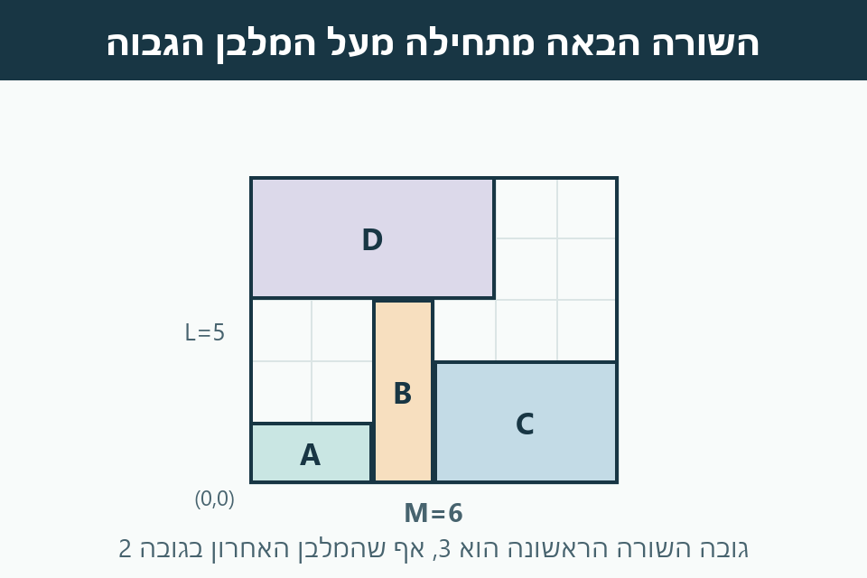
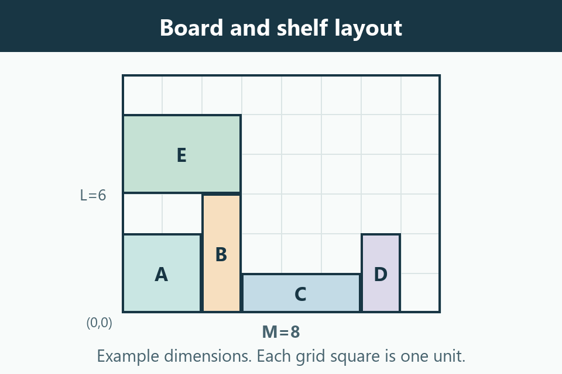
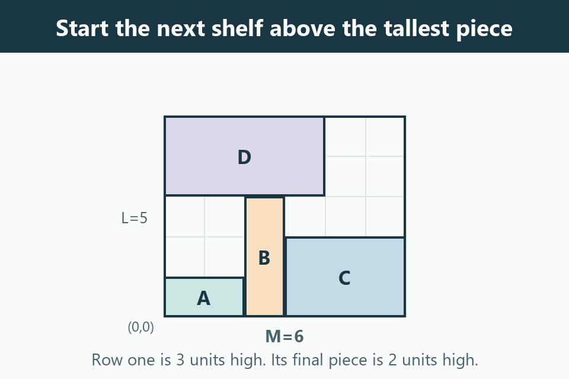

# PREP-381 — סידור מלבנים בשורות על לוח

פתרון מוצע בסיוע AI. ממתין לביקורת מקצועית אנושית.

[צילום המקור](../sources/2026-11-18-batch21-17.png)

[שרטוט הלוח המצורף למקור](../sources/2026-11-18-batch21-18.png)

אתה צריך למלא לוח טטריס בגודל M על L. M מייצג את רוחב הלוח ו-L את אורך הלוח. יש לך פונקציה נתונה get_next שמביאה לך כל פעם צורה אחרת עם רוחב m ואורך l. עליך למלא כל פעם שורה עד הסוף ולאחר מכן לעבור לשורה הבאה (שמתחילה בהתאם ל-l המקסימלי מהשורה הקודמת) וכך עד שכל הלוח מלא ככל הניתן. כתוב קוד אשר ממלא את הלוח, שים לב למקרי קצה.

## סידור מלבנים בשורות על לוח

לוח ברוחב M ובגובה L מקבל זרם סופי של מלבנים בגודל (m,l) דרך get_next(). ערך None מסמן סוף. הציבו אותם בסדר ההגעה משמאל לימין, החל מהפינה השמאלית התחתונה (0,0). התקדמו לרוחב כל שורה. תחתית השורה הבאה נמצאת בגובה ראש המלבן הגבוה בשורה הנוכחית. החזירו לכל מלבן שהוצב את [אינדקס הקלט,x,y] של פינתו השמאלית התחתונה.

לתרגיל זה אין סיבוב, שינוי סדר או מילוי מאוחר של חורים בשורות סגורות. אם המלבן מתאים בהמשך השורה, הציבו אותו שם. אם חסר רוחב, נסו לפתוח עבורו את השורה הבאה. אם המלבן אינו מתאים או שממד שלו אינו חיובי, דלגו עליו והשאירו את השורה הנוכחית פתוחה. מותר לפגוש את שפת הלוח בדיוק. כל הממדים שלמים וממדי הלוח אינם שליליים. הסבירו אילו פערים עלולים להישאר.


### רמזים

1. איזה מידע צריך לשמור כדי להניח את המלבן הבא בלי לסרוק את הלוח?
2. שמרו את הקצה הימני של השורה, את גובה הבסיס שלה ואת גובה המלבן הגבוה בה.
3. לפני סגירת שורה, בדקו שהמלבן נכנס בגובה בבסיס החדש. אם הוא נדחה, שמרו את שלושת הערכים הקודמים.

### פתרון מוצע

שמרו שלושה מספרים. x הוא הקצה הפנוי הבא לרוחב. base הוא גובה תחתית השורה, ו־shelf_height הוא הגובה המרבי של מלבנים שכבר נוספו לשורה. אתחלו את שלושתם לאפס. עבור מלבן תקין בדקו אם קצהו העליון חורג מ־L או שרוחבו גדול מהלוח. במקרה כזה דלגו. אחרת, אם נשאר די רוחב, החזירו את נקודת ההצבה והתקדמו ברוחב המלבן. עדכנו את הגובה המרבי.

אם הרוחב הנותר קטן מדי, חשבו בסיס אפשרי base+shelf_height. רק אם המלבן נכנס בגובה החדש, סגרו את השורה הישנה והתחילו את החדשה ב־x=0. אם אינו נכנס, דילוג בלי לסגור את השורה יכול להשאיר מקום למלבן קטן יותר שיגיע בהמשך. הפסיקו בסוף הזרם. אפשר להפסיק מוקדם גם כשהשורה הגיעה לשפת ימין ושיא גובהה הגיע לשפת הלוח העליונה.

לדוגמה, על לוח 6×5 החלקים (2,1),(1,3),(3,2),(4,2) מונחים בנקודות (0,0),(2,0),(3,0),(0,3). החלק השלישי נמוך מהשני, ולכן החלק הרביעי מתחיל בגובה 3. השורות אינן חופפות מאחר שבסיס שורה חדשה גבוה לפחות כמו החלק העליון של כל מלבן בשורה הקודמת. בתוך השורה טווחי הרוחב זרים. הפער מעל חלק נמוך נשאר ריק כשהשורה נסגרת. זו מדיניות הצבה מקוונת, והיא אינה מבטיחה ניצול שטח מרבי.

```python
def shelf_placements(width, height, get_next):
    """Yield [input index, x, y] for each placement on a fixed board."""
    x = base = shelf_height = 0
    index = 0
    while width > 0 and height > 0:
        piece = get_next()
        if piece is None:
            return
        w, h = piece
        current = index
        index += 1
        if not (0 < w <= width and 0 < h <= height - base):
            continue
        if w > width - x:
            new_base = base + shelf_height
            if h > height - new_base:
                continue
            x, base, shelf_height = 0, new_base, 0
        yield [current, x, base]
        x += w
        shelf_height = max(shelf_height, h)
        if x == width and base + shelf_height == height:
            return


def pack_shelves(width, height, pieces):
    source = iter(pieces)
    return list(shelf_placements(width, height, lambda: next(source, None)))
```



### הנחות

מקור הצירים בשמאל למטה. מלבנים אינם מסתובבים. ניתן לדלג על צורה, ואין חובה לכסות את כל השטח.

### מקרה קצה

מלבן שממלא את השורה בדיוק מותר. חלק שגבוה מהשטח שנותר גם בשורה החדשה נדחה בלי להזיז את נקודת ההצבה.

### טעות נפוצה

גובה המלבן האחרון יכול להיות קטן מגובה השורה. שימוש בו לבדו כמדרגה הבאה עלול לגרום לחפיפה עם מלבן מוקדם יותר.

### סיבוכיות או עלות

O(k) זמן עבור k צורות שנקראו. O(1) זיכרון עזר בנוסף לפלט. אפשר לפלוט כל הצבה מיד.

### בדיקות

נבדקו דריכה לאורך גבולות, צורות רחבות או גבוהות מדי, רוחב ואורך אפס ודילוג לפני צורה שכן נכנסת. הושוו הצבות למודל שסורק במפורש את השורות.

### תשובה קצרה

שומרים קצה רוחב, בסיס וגובה שיא לכל שורה. בחריגה ברוחב פותחים שורה חדשה רק אם ההצבה שם חוקית.

### שאלת המשך

האם מיון המלבנים מראש עשוי לשפר את הניצול? למשל, קיבוץ גבהים דומים עשוי לצמצם חללים. מיון דורש לקבל את הקלט מראש ומשנה את אילוץ סדר ההגעה.

## Place a stream of rectangles on shelves

A board of width M and height L receives a finite stream of (m,l) rectangles from get_next(). None ends the stream. Place them in arrival order from left to right, starting at bottom left (0,0). A new row starts at the top of the tallest rectangle in the current row. Return [input index,x,y] for the bottom-left corner of each placed rectangle.

For this exercise there is no rotation, reordering or later backfilling of closed rows. If the rectangle fits at the end of the current row, place it there. When it lacks horizontal space, try starting the next row for it. If it does not fit, or either dimension is nonpositive, skip it and keep the current row open. Touching the board edge is allowed. All dimensions are integers and board dimensions are nonnegative. Explain where gaps may remain.



### Hints

1. What information would let you place a rectangle without scanning the board?
2. Keep the next horizontal position, the row base and the height of the tallest piece placed in it.
3. Before closing a row, test the candidate at the prospective new base. Preserve the current row if the candidate is rejected.

### Proposed solution

Keep three numbers. x is the next horizontal position, base is the bottom of the row, and shelf_height is the maximum height of the rectangles already placed in that row. Initialize all three to zero. Skip a nonpositive rectangle, a rectangle wider than the board or one too tall even at the current base. If enough width remains, emit its placement, advance x by its width and update the maximum height.

When width runs out, compute the prospective base as base+shelf_height. Close the row only when the rectangle fits above that new base, then start at x=0. Otherwise skip it and preserve the row so a smaller later piece may still fit. Stop when the stream ends. It is also safe to stop once the row reaches the right edge and its tallest piece reaches the board top.

For a 6×5 board, pieces (2,1),(1,3),(3,2),(4,2) land at (0,0),(2,0),(3,0),(0,3). The third rectangle is shorter than the second, so the fourth starts at height 3. The base of each new row is at least as high as the top of each piece in the preceding row, and horizontal intervals within a row are disjoint. Gaps above short pieces remain unused when a row closes. This online policy does not guarantee maximum occupied area.

```python
def shelf_placements(width, height, get_next):
    """Yield [input index, x, y] for each placement on a fixed board."""
    x = base = shelf_height = 0
    index = 0
    while width > 0 and height > 0:
        piece = get_next()
        if piece is None:
            return
        w, h = piece
        current = index
        index += 1
        if not (0 < w <= width and 0 < h <= height - base):
            continue
        if w > width - x:
            new_base = base + shelf_height
            if h > height - new_base:
                continue
            x, base, shelf_height = 0, new_base, 0
        yield [current, x, base]
        x += w
        shelf_height = max(shelf_height, h)
        if x == width and base + shelf_height == height:
            return


def pack_shelves(width, height, pieces):
    source = iter(pieces)
    return list(shelf_placements(width, height, lambda: next(source, None)))
```



### Assumptions

Use lower-left coordinates. Rectangles are fixed in orientation. Skips are allowed and complete tiling is not required.

### Edge case

An exact width fit is legal. Rejecting a rectangle whose new row would exceed the height must preserve room for the next input.

### Common mistake

The most recently placed rectangle may be shorter than an earlier one. Starting the next row at its top alone can cause overlap.

### Cost

O(k) time for k pieces read and O(1) auxiliary storage beyond the output. Each placement can be emitted immediately.

### Verification

Compared placements against an explicit shelf model. Checked exact fits, oversized pieces, zero dimensions and a skipped piece followed by one that fits.

### Interview answer

Track the next x, the base and peak height. On horizontal overflow start a new row only when the candidate fits there.

### Follow-up

Can sorting the pieces in advance improve utilization? Grouping similar heights may reduce gaps, but sorting requires advance access and changes the input-order constraint.

[checks/check_nov18b_software.py](../checks/check_nov18b_software.py)

[checks/prep-381-1118b-verification.json](../checks/prep-381-1118b-verification.json)

[solutions/prep_381_shelf_rectangles.py](../solutions/prep_381_shelf_rectangles.py)
