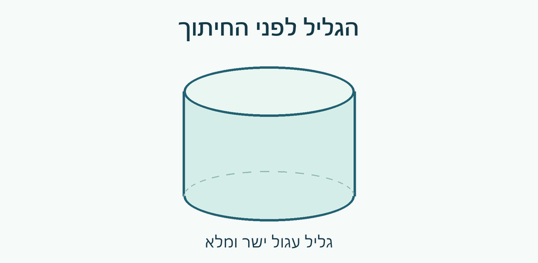
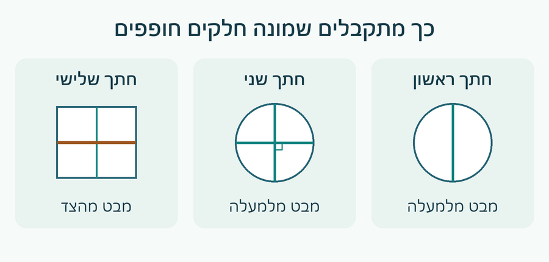
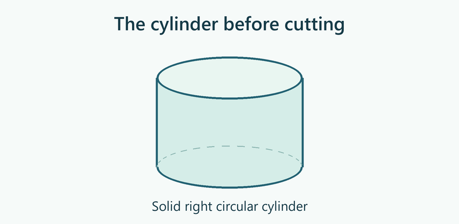
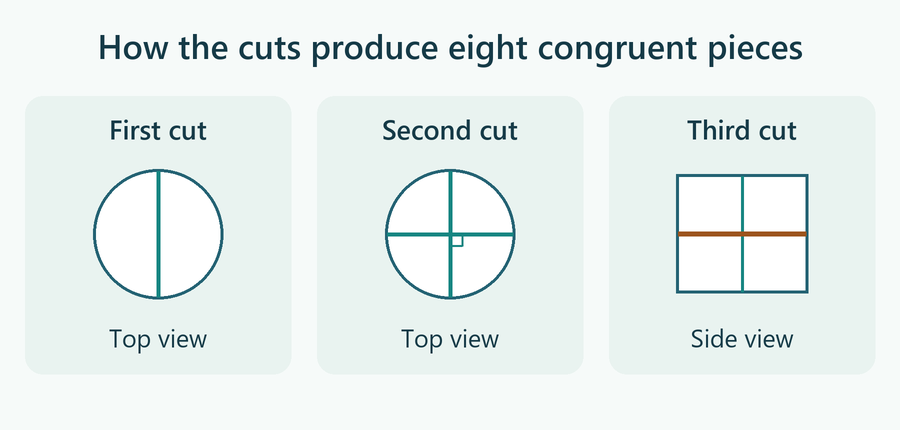

# PREP-382 — שמונה חלקים חופפים בשלושה חיתוכים

פתרון מוצע בסיוע AI. ממתין לביקורת מקצועית אנושית.

[צילום המקור](../sources/2026-11-18-batch21-09.png)

חלקו בעזרת שלושה חיתוכים בלבד את הגליל ל-8 חלקים זהים

## שמונה חלקים חופפים בשלושה חיתוכים

נתון גליל עגול ישר ומלא, כמו בשרטוט. איך חותכים אותו לשמונה חלקים חופפים בשלושה חיתוכים מישוריים? בכל חיתוך מישור אחד עובר דרך הגליל כולו. החלקים נשארים במקומם בין החיתוכים. הסבירו מדוע אפשר להניח כל חלק בדיוק על כל חלק אחר.

### רמזים

1. אחרי החיתוך הראשון יש שני חלקים. בכמה חלקים חייב לפגוע החיתוך הבא כדי שאפשר יהיה להגיע לשמונה?
2. הסתכלו על הגליל מלמעלה. אילו שני קווים מחלקים את העיגול לארבע גזרות חופפות?
3. שני מישורים דרך ציר הגליל כבר מחלקים את הבסיס. באיזה גובה יעבור מישור שיחצה את כל ארבעת החלקים?

### פתרון מוצע

### בוחרים שני קטרים וגובה אחד
במבט מלמעלה מסמנים שני קטרים ניצבים. מעבירים חתך אנכי לכל אורך הגליל לאורך הקוטר הראשון, וחתך אנכי שני לאורך הקוטר השני. מתקבלים ארבעה רבעי גליל בגובה המלא. החיתוך השלישי מקביל לבסיסים ועובר בדיוק בחצי הגובה. הוא חוצה את כל ארבעת הרבעים בבת אחת.

לכל חלק בסיס בצורת רבע עיגול באותו רדיוס וגובה השווה למחצית גובה הגליל. סיבוב סביב ציר הגליל בכפולה של רבע סיבוב מתאים בין רבעים באותה שכבה. הזזה אנכית במחצית הגובה מתאימה בין השכבות. כך מתקבלות שמונה צורות חופפות.

**מדוע שלושה חיתוכים נחוצים?** החלקים בכל שלב קמורים, ולכן מישור יכול לחלק כל חלק לכל היותר לשניים. בשני חיתוכים אפשר לקבל לכל היותר ארבעה חלקים.

### הנחות

גליל עגול ישר. מישורי החיתוך עוברים דרך כל הגוף והחלקים נשארים במקומם.

### מקרה קצה

שני קטרים בזווית של 60 מעלות יוצרים גזרות בשתי מידות. מישור בגובה שאינו האמצע יוצר שכבות בגבהים שונים.

### טעות נפוצה

בדיקת נפח בלבד אינה מוכיחה שאפשר לחפוף בין שתי צורות.

### סיבוכיות או עלות

שלושה חיתוכים מספיקים, ושני חיתוכים יכולים ליצור לכל היותר ארבעה חלקים.

### בדיקות

נבדקו ארבעת תחומי הזווית ושני תחומי הגובה בחשבון רציונלי. התחומים מכסים את הגליל, ופנימיהם זרים.

### תשובה קצרה

שני חתכים אנכיים דרך הציר בזווית ישרה יוצרים ארבעה רבעים. חתך אופקי בחצי הגובה הופך כל רבע לשני רבעים חופפים.

### שאלת המשך

איך משתנה הבנייה אם חתך אחד כבר בוצע במקביל לבסיסים בדיוק בחצי הגובה? מבצעים את שני החתכים האנכיים הניצבים דרך הציר. כל אחד עובר בשתי השכבות.

## Eight congruent pieces in three cuts

A solid right circular cylinder is shown below. How can you divide it into eight congruent pieces using three plane cuts? Each cut passes through the entire cylinder, and the pieces stay in place between cuts. Explain how any piece can fit exactly onto any other.

### Hints

1. After the first cut there are two pieces. How many must the next cut intersect to leave eight pieces achievable?
2. Look at the circular base from above. Which two lines divide it into four congruent sectors?
3. Two planes through the cylinder axis divide the base. At what height could a plane bisect all four pieces?

### Proposed solution

### Choose two diameters and one height
In the top view, draw two perpendicular diameters. Make a vertical cut along the first diameter, from top to bottom, then a vertical cut along the second. This gives four full-height quarter cylinders. Make the third cut parallel to the bases, exactly halfway up. It bisects all four quarters at once.

Each piece has a quarter-disk base of the same radius and half the original height. A rotation around the axis by a multiple of a quarter turn aligns any two quarters in a layer. A vertical translation by half the cylinder height aligns matching quarters in the two layers. This establishes congruence for all eight pieces.

**Why are three cuts necessary?** Each intermediate piece is convex, so a plane can split it into at most two. Two cuts can produce at most four pieces.

### Assumptions

The cylinder is right and circular. Each cut is a plane through the entire solid and the pieces stay in position.

### Edge case

Diameters meeting at 60 degrees produce two different sector angles. An off-center horizontal cut produces two different heights.

### Common mistake

Checking volume alone does not establish that the pieces fit exactly onto one another.

### Cost

Three cuts suffice, and two cuts can produce at most four pieces.

### Verification

The four angular intervals and two height intervals were checked with rational arithmetic for full coverage and disjoint interiors.

### Interview answer

Make perpendicular vertical cuts through the axis to get four quarters. A horizontal cut at half height bisects all four quarters into congruent pieces.

### Follow-up

What if the horizontal mid-height cut has already been made? Make the same two perpendicular axial cuts, passing through both layers each time.

[checks/check_1118b_cylinder_cards_hourglasses.py](../checks/check_1118b_cylinder_cards_hourglasses.py)

[checks/prep-382-1118b-verification.json](../checks/prep-382-1118b-verification.json)
