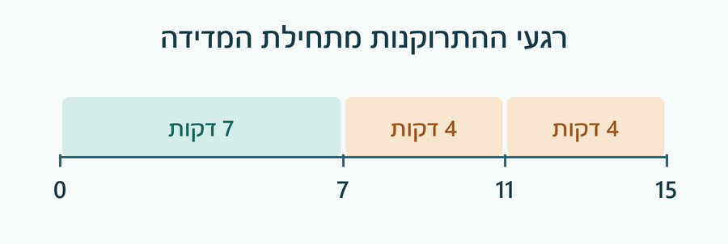
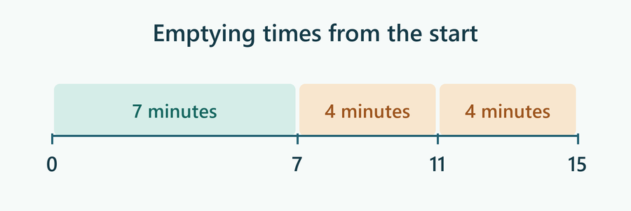

# PREP-384 — רבע שעה בשני שעוני חול

פתרון מוצע בסיוע AI. ממתין לביקורת מקצועית אנושית.

[צילום המקור](../sources/2026-11-18-batch21-21.png)

ישנם שני שעוני חול של 7 דקות ואחד של 4 יש למדוד 15 דקות

## רבע שעה בשני שעוני חול

לרשותכם שעון חול של ארבע דקות ושעון חול של שבע דקות. איך תמדדו בדיוק 15 דקות החל מרגע שתבחרו להתחיל? מותר להתחיל כל שעון בנפרד ולהפוך אותו שוב כשיתרוקן. אפשר לזהות מתי החול נגמר, ואין על השעונים סימוני ביניים.

### רמזים

1. האם נחוץ ששני השעונים יעבדו במקביל?
2. אם מתחילים בשבע דקות שלמות, כמה דקות עדיין חסרות?
3. אילו שני מחזורים שלמים של אותו שעון מסתכמים בזמן שנותר?

### פתרון מוצע

### מחברים שלושה פרקי זמן שלמים
בתחילת המדידה מפעילים את השעון של שבע הדקות. כשהוא מתרוקן מפעילים את השעון של ארבע הדקות. כשהשעון הקצר מתרוקן בפעם הראשונה, הופכים אותו מיד. בהתרוקנות הבאה מסתיימת המדידה.

רגעי המעבר, בדקות מתחילת המדידה, הם `0 → 7 → 11 → 15`. משכי ההפעלה הרצופים הם 7, 4 ו־4 דקות. ההתרוקנות עצמה מסמנת כל מעבר, ולכן אין צורך להעריך זמן לפי גובה החול.

### הנחות

השעונים מדויקים, מוכנים להפעלה מלאה והופכים אותם ברגע האירוע.

### מקרה קצה

אם שני השעונים חייבים להתחיל יחד, אפשר להפוך את הקצר כשהוא מתרוקן בדקה 4. הארוך מתרוקן בדקה 7 וממתין. בהתרוקנות השנייה של הקצר, בדקה 8, הופכים את הארוך ומקבלים סימן בדקה 15.

### טעות נפוצה

לחבר את זמניהם של שני שעונים שרצו במקביל, כאילו פרקי הזמן שלהם עברו זה אחר זה.

### סיבוכיות או עלות

בהפעלה טורית של מחזורים שלמים די בשלוש הרצות. שתי הרצות כאלה נמשכות לכל היותר 14 דקות.

### בדיקות

חושב זמן כל התרוקנות גם בהפעלה טורית וגם בגרסה שבה שני השעונים מתחילים יחד.

### תשובה קצרה

שבע דקות בשעון הארוך ושתי הרצות רצופות של ארבע דקות בשעון הקצר מסמנות 15 דקות מתחילת המדידה.

### שאלת המשך

אילו משכים תוכלו למדוד ברצף של מחזורי חול שלמים? כל משך שניתן לכתוב בתור 4a+7b, כאשר a ו־b שלמים אי־שליליים, מתקבל על ידי שרשור המחזורים.

## Fifteen minutes with two hourglasses

You have a four-minute hourglass and a seven-minute hourglass. How can you measure exactly 15 minutes from a start of your choice? You may start the glasses separately and turn a glass again once it empties. You can tell when a glass empties, but the glasses have no intermediate markings.

### Hints

1. Do both glasses have to run at the same time?
2. If you start by measuring seven whole minutes, how long remains?
3. Which two full runs of the same glass add up to the remaining time?

### Proposed solution

### Add three consecutive full runs
At the start of the interval, start the seven-minute glass. When it empties, start the four-minute glass. When the shorter glass empties for the first time, turn it immediately. Its next emptying marks the end of the interval.

The event times in minutes from the start are `0 → 7 → 11 → 15`. The three successive runs last 7, 4 and 4 minutes. Every transition is signaled by an empty glass, so the sand level never needs to be estimated.

### Assumptions

Both glasses are accurate and ready for a full run. Turning takes negligible time.

### Edge case

If both glasses must start together, turn the short one at minute 4. Leave the long one empty after minute 7. At the second emptying of the short glass, minute 8, turn the long one. It empties at minute 15.

### Common mistake

Adding the durations of overlapping runs as though the runs occupied successive intervals.

### Cost

Three serial full runs suffice. Two serial full runs can last at most 14 minutes.

### Verification

The emptying times were checked for the serial schedule and for the variant where both glasses must be started together.

### Interview answer

Run the seven-minute glass once, then run the four-minute glass twice consecutively. Its final emptying marks 15 minutes from the start.

### Follow-up

Which durations can be measured by a sequence of full runs? Every duration of the form 4a+7b for nonnegative integers a and b can be measured by chaining that many runs.

[checks/check_1118b_cylinder_cards_hourglasses.py](../checks/check_1118b_cylinder_cards_hourglasses.py)

[checks/prep-384-1118b-verification.json](../checks/prep-384-1118b-verification.json)
