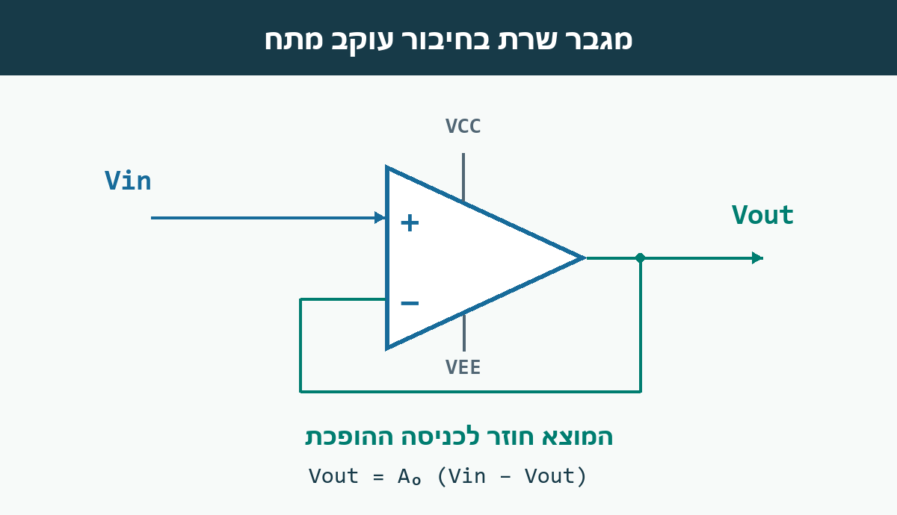
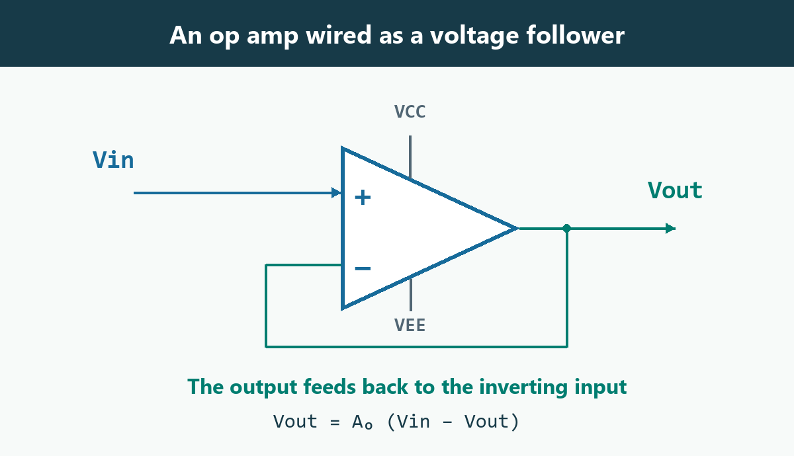

# PREP-385 — מהו מגבר שרת וכיצד משוב שלילי קובע את המוצא?

הצעה לפתרון. ביקורת מקצועית אנושית ממתינה.

## עברית

הסבירו מהו מגבר שרת. ציינו מה מייצגות שתי הכניסות, מה מזין את המוצא, ומה קובע את מתחו בחוג פתוח. הדגימו באמצעות עוקב מתח כיצד חיבור המוצא לאחת הכניסות משנה את ההתנהגות. מתי מותר להניח שמתחי הכניסות כמעט שווים?

1. איזה הפרש משנה את המוצא כאשר מגביהים את הכניסה המסומנת בפלוס?
2. בעוקב מתח חברו את המוצא לכניסה ההופכת. מה יקרה להפרש הכניסות אם המוצא יעלה מעט מעל הערך הדרוש?
3. כתבו את משוואת החוג עם הגבר סופי. בדקו אם מתח המוצא המחושב נמצא בתחום האפשרי.

מגבר שרת הוא מגבר מתח הפרשי. הוא דוגם את המתח בכניסה הלא־הופכת ובכניסה ההופכת, ומספק מתח וזרם לעומס בעזרת ספקי הכוח. בתדר נמוך ובתחום הליניארי מתקיים `Vout=A₀(V+−V−)`. הגדלת מתח הכניסה החיובית ביחס לשלילית דוחפת את המוצא כלפי מעלה. במודל אידאלי עכבת הכניסה אינסופית ועכבת המוצא אפס. ברכיב ממשי יש זרמי הטיה קטנים ומגבלה על זרם המוצא.

**חוג פתוח.** ההגבר בדרך כלל גדול. למשל בהגבר של 100,000 הפרש של 1 mV דורש מוצא של 100 V לפי המשוואה הליניארית. אם תחום היציאה הזמין הוא מ־‎−4 V עד ‎+4 V, המוצא יגיע לאזור הרוויה החיובית. גבולות התנודה תלויים ברכיב, באספקה ובעומס.

**חוג סגור.** בעוקב מחברים את האות לכניסה החיובית ואת המוצא ישירות לכניסה השלילית. עלייה במוצא מקטינה את הפרש הכניסות וכך מתקנת את השגיאה. מתקבל `Vout=A₀(Vin−Vout)`, כלומר `Vout/Vin=A₀/(1+A₀)`. בהגבר 100,000 ובכניסה של 1 V המוצא הוא כ־0.999990 V, וההפרש בין הכניסות כ־10 µV. מתחי הכניסות קרובים כאשר המשוב השלילי יציב, הגבר החוג גדול והרכיב פועל בתחום הליניארי. במעגל ממשי בודקים גם את תחום המתח המשותף בכניסות, רוחב הפס ומגבלות העומס.

## English

Explain what an operational amplifier is. Identify its two inputs and the source of output power. What sets its open-loop output voltage? Use a voltage follower to show how feeding the output back to an input changes its behavior. When may you approximate the two input voltages as equal?

1. Which voltage difference increases when the non-inverting input rises?
2. Connect the follower output to its inverting input. How does the input difference respond if the output rises slightly too far?
3. Write the loop equation with finite open-loop gain. Check that the predicted voltage lies within the available output swing.

An op amp is a differential voltage amplifier. It senses the non-inverting and inverting input voltages and draws power from its supplies to drive the load. At low frequency in the linear region, `Vout=A₀(V+−V−)`. Raising the non-inverting input relative to the inverting input moves the output up. The ideal model has infinite input impedance and zero output impedance. A physical part draws bias currents and has a finite output-current limit.

**Open loop.** Gain is usually large. With a gain of 100,000, a 1 mV input difference would demand 100 V from the linear model. If the available swing runs from −4 V to +4 V, the output reaches positive saturation. Actual swing depends on device, supplies and load.

**Closed loop.** In a follower the signal drives the non-inverting input and the output connects directly to the inverting input. If the output rises too far the differential input falls, correcting the error. Then `Vout=A₀(Vin−Vout)`, giving `Vout/Vin=A₀/(1+A₀)`. With a gain of 100,000 and a 1 V input, the output is about 0.999990 V and the input difference is about 10 µV. Near-equal input voltages require stable negative feedback, large loop gain and linear operation. A real design also checks input common-mode range, bandwidth and loading.

[צילום מקור פנימי 2](../sources/2026-11-18-batch21-02.png)
[קובץ המימוש](../solutions/digital1118b_models.py)
[תוצאות בדיקות](../checks/digital1118b-verification.json)
