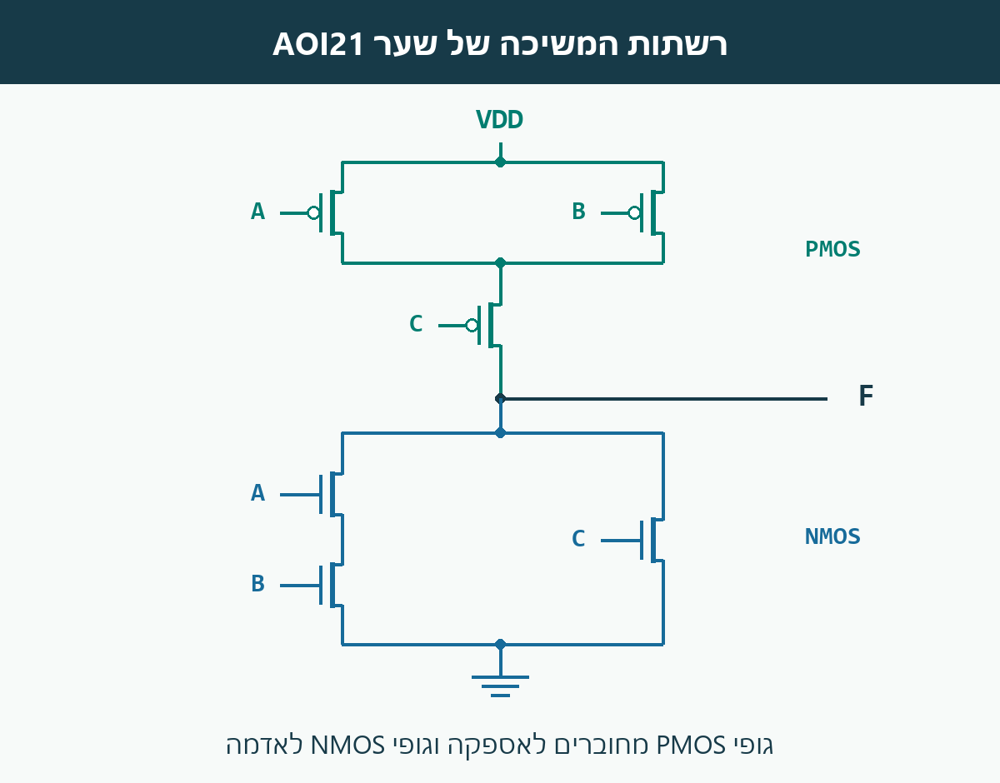
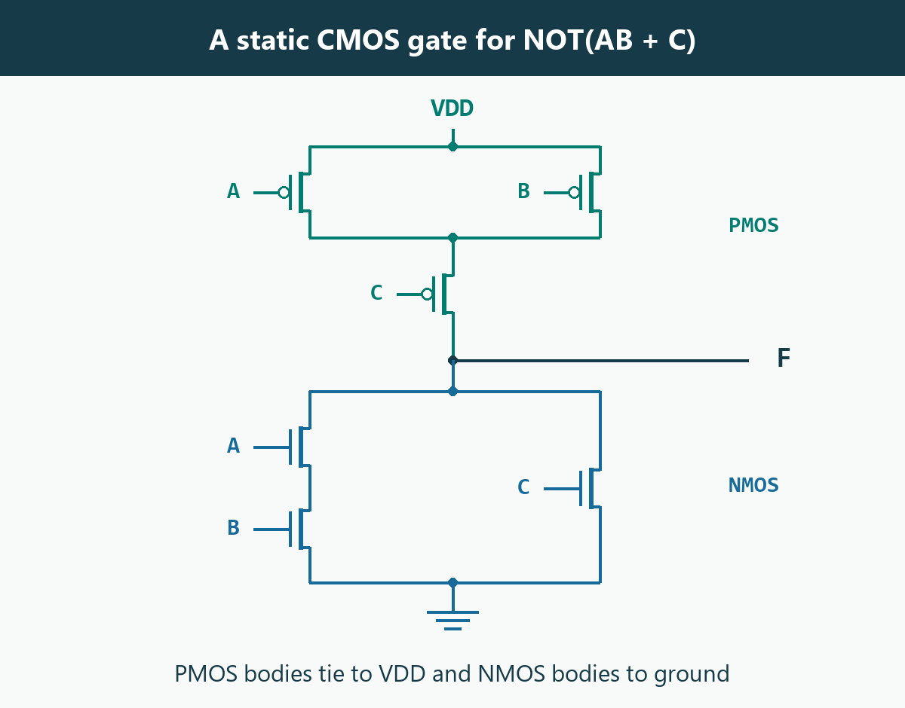

# PREP-386 — מימוש הפונקציה ‎¬(AB+C) ב־CMOS משלים

הצעה לפתרון. ביקורת מקצועית אנושית ממתינה.

## עברית

ממשו את F=NOT((A AND B) OR C) באמצעות שער CMOS סטטי משלים. הקלטים חד־סיביים ויציבים. שרטטו את רשתות המשיכה לאספקה ולאדמה, ציינו איזה קלט שולט בכל טרנזיסטור והראו מדוע המוצא מוגדר בכל אחד משמונת צירופי הקלט.

1. באילו מצבי קלט צריך לקבל אפס?
2. בענף המוליך לאדמה, חיבור בטור דורש שתי הולכות וחיבור במקביל דורש אחת.
3. החליפו את כל רכיבי ה־NMOS ב־PMOS ואת כל הטורים במקבילים ולהפך, ובדקו את המקרה שבו C לבדו מופעל.

בונים תחילה את מסלולי ההולכה לאדמה. כדי לאפס את F די ש־C יהיה 1, או שגם A וגם B יהיו 1. לכן טרנזיסטור NMOS הנשלט ב־C מחובר במקביל לענף ובו שני טרנזיסטורי NMOS בטור הנשלטים ב־A וב־B. ענף מקביל יכול לבדו לחבר את F לאדמה.

הפלט גבוה כאשר `¬C ∧ (¬A ∨ ¬B)`. טרנזיסטור PMOS מוליך כשהשער נמוך. בין האספקה ל־F מחברים את טרנזיסטור C בטור לזוג A ו־B המחוברים במקביל. מחברים את גופי ה־PMOS לאספקה ואת גופי ה־NMOS לאדמה בטכנולוגיית bulk המקובלת. במימוש זה שישה טרנזיסטורים.

| A | B | F כאשר C=0 | F כאשר C=1 |
| --- | --- | --- | --- |
| 0 | 0 | 1 | 0 |
| 0 | 1 | 1 | 0 |
| 1 | 0 | 1 | 0 |
| 1 | 1 | 0 | 0 |

כאשר C=1 רכיב ה־NMOS שלו מושך לאדמה ורכיב ה־PMOS שלו מנתק את האספקה. כאשר C=0 נותר לבחון את A ו־B. רק בשורה 11 יש מסלול תחתון שלם ובשלוש השורות האחרות קיים מסלול עליון שלם. מכאן שבכל שורה יציבה מחוברת רשת אחת בלבד. בזמן מעבר ייתכנו זרם קצר וטעינת קיבול מוצא.

## English

Implement F=NOT((A AND B) OR C) as one static complementary CMOS gate with stable one-bit inputs. Draw both pull networks, label each transistor gate and show why the output is defined for all eight input combinations.

1. For which input values must the output be zero?
2. On a path to ground, series devices must both conduct. Parallel branches only need one conducting branch.
3. Swap NMOS for PMOS and series for parallel. Check the case in which only C is high.

Start with paths to ground. F must go low when C is high, or when A and B are both high. Connect the NMOS controlled by C in parallel with a series pair driven by A and B. Either complete branch can pull F to ground.

The high-output condition is `¬C ∧ (¬A ∨ ¬B)`. A PMOS conducts when its gate is low. Between the supply and F place the C PMOS in series with two parallel PMOS devices driven by A and B. In conventional bulk CMOS tie PMOS bodies to VDD and NMOS bodies to ground. This implementation uses six devices.

| A | B | F with C=0 | F with C=1 |
| --- | --- | --- | --- |
| 0 | 0 | 1 | 0 |
| 0 | 1 | 1 | 0 |
| 1 | 0 | 1 | 0 |
| 1 | 1 | 0 | 0 |

With C high, its NMOS conducts to ground and its PMOS interrupts the supply path. With C low, A and B decide the output. Only 11 closes the lower branch. Each other row closes an upper branch. Exactly one network conducts for every settled binary input. During transitions the circuit can draw short-circuit current and charge its output capacitance.

[צילום מקור פנימי 13](../sources/2026-11-18-batch21-13.png)
[קובץ המימוש](../solutions/digital1118b.sv)
[תוצאות בדיקות](../checks/digital1118b-verification.json)
